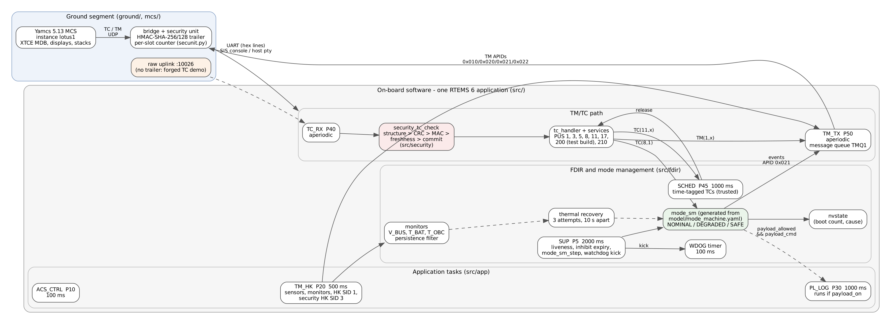

# LOTUS-1 flight software

[](https://github.com/Truongtm-2604mJ/flight-sw-truong/actions/workflows/fast-checks.yml)
[](https://github.com/Truongtm-2604mJ/flight-sw-truong/actions/workflows/nightly-target.yml)

Flight software for LOTUS-1, a small Earth observation satellite. It runs on RTEMS 6 on a LEON3 processor
(SIS) and is operated from a Yamcs mission control system. The software covers PUS-C telecommand and
telemetry, autonomous fault detection and recovery, a mode manager generated from a model, and
authenticated commanding. It comes with its requirements, tests and evidence.

## Demonstration

**▶ [Watch the 3-minute demonstration](https://youtu.be/Cp3vAMY7QOk)**: the full scenario operated from Yamcs.

1. Boot to NOMINAL, with HK at 1 Hz.
2. An authenticated TC enables the payload.
3. A forged TC is rejected silently, with a security event.
4. A battery over-temperature: one event, DEGRADED, payload suspended.
5. Three recovery attempts fail, so the vehicle goes to SAFE.
6. Operators recover with procedure SAFE-01.
7. CI is green for the same commit.

| Step | Measured (onboard time) |
|---|---|
| Forged TC (wrong key) | no reply of any kind; one `REJECT_FIRST AUTH` event; payload unchanged |
| T_BAT over 45 °C | one alarm event **3.00 s** after onset (3-sample persistence); DEGRADED in the same cycle |
| Bounded recovery | 3 attempts **10.0 s** apart; SAFE **35.0 s** after onset; payload off, schedule suspended, essential TM |
| Ground SAFE exit | authenticated; NOMINAL **2.00 s** after TM(1,7) (requirement ≤ 3.0 s) |

Run it yourself: `make scenario` (headless, about 2 min) or `make demo` with Yamcs (`demo/README.md`).

## Architecture



| Task | Priority | Period | Role |
|---|---:|---|---|
| SUP | 5 | 2 s | liveness supervision, mode machine step, watchdog kick |
| ACS_CTRL | 10 | 100 ms | control loop |
| TM_HK | 20 | 500 ms | sampling, limit monitoring, thermal recovery, housekeeping, key scrub |
| PL_LOG | 30 | 1 s | payload (only when enabled and in NOMINAL) |
| TC_RX | 40 | aperiodic | authentication, PUS command handling |
| SCHED | 45 | 1 s | time-tagged commands (PUS 11) |
| TM_TX | 50 | aperiodic | downlink |

- **TM/TC:** CCSDS Space Packets, PUS-C services 1, 3, 5, 8, 11, 12, 17, 19 and 210 (key management).
- **FDIR:**
  - limit monitors with persistence and hysteresis;
  - heartbeat supervision with bounded restarts;
  - a watchdog that resets into SAFE;
  - bounded thermal recovery.
- **Modes:** NOMINAL, DEGRADED and SAFE, generated from `model/mode_machine.yaml`. SAFE is left only by
  ground command.
- **Security:**
  - HMAC-SHA-256/128 trailer and an anti-replay counter;
  - no reply to unauthenticated commands;
  - three-copy key store with scrubbing;
  - rekey, and a minimal recovery key.

Details: [`docs/architecture.md`](docs/architecture.md), [`docs/mission.md`](docs/mission.md),
[technical report (PDF)](docs/report/LOTUS-1-technical-report.pdf).

## Build

```
make                    # host simulation builds: build/host/lotus1-{test,flight}.host
make rtems RTEMS_PREFIX=$HOME/quick-start/rtems/6    # LEON3 images in build/rtems/
make check-generated    # src/fdir/mode_sm.* match the model
```

The host builds use `-Wall -Wextra -Werror`. `make warnings` builds every flight source at the maximum
warning set, both builds, with 0 warnings.

## Test

```
make test               # warnings, unit (Unity), integration, validation campaign (host)
make scenario           # the 7-step mission scenario, automated
make -C tests static coverage-full mcdc    # static analysis, coverage, MC/DC
make sis RTEMS_PREFIX=...                  # on SIS: timing, scenario, integration, validation
```

## Results

| Evidence | Result |
|---|---|
| Requirements | 30, traced to design, code and tests: [`evidence/traceability-matrix.md`](evidence/traceability-matrix.md) |
| Unit tests | 9 suites, 142 tests, all pass |
| Integration | 16/16 (host simulation of RTEMS; SIS in the nightly job) |
| Validation | 35 tests through the ground interface: 33 PASS, 1 FAIL (VT-TMTC-040, NCR-01, deferred), 1 observation |
| Coverage | 96.6 % of flight lines, 84.4 % of branches, cumulative over unit + integration + validation (core modules 98.2 %); every other line classified. The fast-checks pipeline alone (unit + integration) gives less. |
| Static analysis | GCC, clang `-Weverything`, cppcheck + MISRA C:2012, clang and GCC analysers: 178 findings, each fixed, justified or accepted with its risk (`evidence/static-analysis/`) |
| Timing | U = 0.393 for the integrated estimate, every task R ≤ T ([`evidence/timing/`](evidence/timing/)) |
| Open items | NCR-01 (deferred), NCR-04, OBS-01, OBS-02: [`evidence/ncr-log.md`](evidence/ncr-log.md) |

Start at [`evidence/README.md`](evidence/README.md).

## Repository

| Path | Content |
|---|---|
| `src/` | the flight application (core, fdir, security, app; host simulation of RTEMS in `sim/`) |
| `model/` | mode machine model, generator, semantics |
| `ground/`, `mcs/` | ground codec and security unit; Yamcs instance, MDB, displays, procedures |
| `tests/` | unit, integration and validation tests; coverage and static analysis scripts |
| `evidence/` | requirements, traceability, coverage, static analysis, NCR log, timing |
| `demo/` | the mission scenario (automated, and through Yamcs for the recording) |
| `docs/` | architecture, mission, report, presentation |
| `labs/` | history: one folder per session (3 to 8), kept as written |

Built in the Refonte Learning Spacecraft Software Engineer Program (2026) by Tran Manh Truong.
