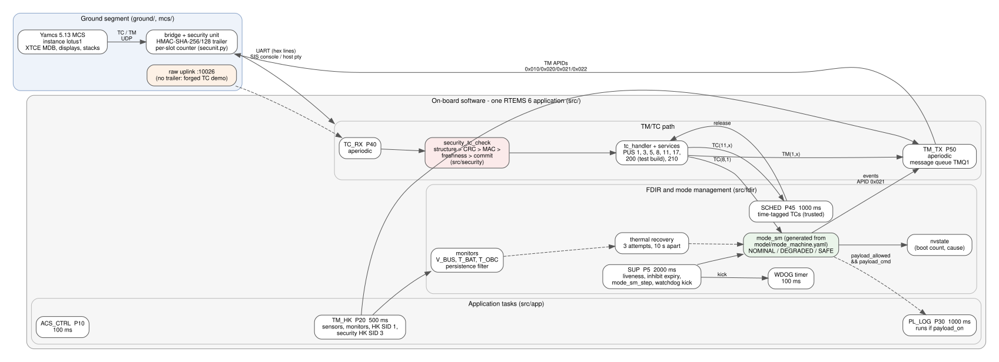

# LOTUS-1 flight software: architecture

This document describes the integrated application built from Sessions 3 to 8.
The code is in `src/`, and the labs in `labs/` are kept as the history of each
session. The task table and the source map below were checked against the code
(`src/app/main.c`, `src/app/mission.h`, `src/app/tmtc.c`, `src/fdir/fdir.c`).

*Figure 1. One RTEMS 6 application on LEON3 (SIS) or on the host simulation.
Source: `docs/figures/architecture.dot`.*

## 1. Task architecture

| Task | RTEMS name | Priority | Period / trigger | Work | Supervised | Stack |
|---|---|---:|---|---|---|---|
| SUP | `SUP1` | 5 | 2000 ms | liveness of the supervised tasks, inhibit expiry, one `mode_sm_step`, NV write on transition, watchdog kick | (kicks the watchdog) | 8 KiB |
| ACS_CTRL | `ACS1` | 10 | 100 ms | attitude control stand-in, about 20 ms | yes | minimum |
| TM_HK | `HK11` | 20 | 500 ms | sensor sampling, monitors (V_BUS, T_BAT, T_OBC), thermal recovery step, HK SID 1, security HK SID 3 and key store scrub | yes | 8 KiB |
| PL_LOG | `LOG1` | 30 | 1000 ms | payload logging, about 100 ms, only while `payload_on` | yes | minimum |
| TC_RX | `TCRX` | 40 | aperiodic (UART line) | security check, then `tc_handler` and the PUS services | no (blocked on input) | 8 KiB |
| SCHED | `SCHD` | 45 | 1000 ms | releases due time-tagged TCs (service 11) as trusted | no | 8 KiB |
| TM_TX | `TMTX` | 50 | aperiodic (queue `TMQ1`) | downlink of every TM packet | no | 8 KiB |
| WDOG | timer `WDOG` | clock tick ISR | 100 ms | hardware watchdog model: resets if not kicked | n/a | n/a |

Priorities follow the rate monotonic order for the periodic tasks (Lab 3.2).
SUP is above them because a supervisor that a busy task can delay cannot
detect that task. TC_RX is below every periodic task except SCHED, so a flood
of uplink frames (valid or forged) cannot take CPU from control or
housekeeping. SCHED is below TC_RX so ground commands are handled before
stored ones.

**Shared resources and locks.** Three binary semaphores with priority
inheritance: the tc lock (`TCLK`, the whole TC path including scheduled
release), the mode lock (mode machine, payload state) and the event lock (the
event packet counter). The lock order is tc, then mode, then event (in
`src/app/tmtc.h`). No code takes them in another order. The longest blocking
any task can see is one key load TC(210,1) under the tc lock (accept and load,
about 4.2 ms estimated). The timing budget uses this value for B.

**Timing budget.** `evidence/timing/` (response time analysis of this task set). The estimate closes with
U = 0.393 and every R ≤ T. The SIS measurement comes from `make sis`.

## 2. Source map

| Directory | File | From (lab) | Role |
|---|---|---|---|
| `src/core` | `sp.c` | 4.1 | CCSDS Space Packet encode and decode |
| | `crc16.c`, `pus.c` | 4.2 | CRC-16/CCITT; PUS-C TC and TM headers, verification reports |
| | `tc_handler.c` | 4.2 | TC acceptance, dispatch to services, PUS 1 reports |
| `src/fdir` | `monitor.c` | 5.1 | limit monitors with persistence filtering |
| | `supervisor.c`, `watchdog.c`, `nvstate.c` | 5.2 | liveness, watchdog model, NV boot record |
| | `schedule.c` | 5.3 | time-tagged command store (service 11) |
| | `mode_sm.c/.h`, `mode_sm_trace.json` | 6.2 (generated) | mode machine from `model/mode_machine.yaml` |
| | `fdir.c`, `fdir.h` | 6 app `fdir6.c` | FDIR glue: events, HK SID 1, mode requests, payload state |
| | `mode_types.h` | 5.3 `modes.h` (types only) | mode, cause and event types |
| | `thermal.c/.h` | new (capstone) | bounded thermal recovery attempts |
| `src/security` | `tc_auth.c`, `sec_report.c` | 8.1 | MAC trailer check, rejection reporting |
| | `keystore.c`, `sec_service.c` | 8.2 | key slots, counters, service 210 |
| | `security.c/.h` | 8 app `sec_app.c` | binding into the application (no linker wraps) |
| `src/app` | `main.c` | 5 app `lab5.c` | RTEMS configuration, tasks, boot |
| | `tmtc.c/.h` | 5 app `tmtc5.c` | TC_RX, TM_TX, queues, tc lock |
| | `services.c/.h` | 5 app `services.c` | PUS 3, 8, 11, 17, 200 handlers |
| | `sensors.c/.h`, `mission.h` | 5 app `sensors5.c`, `fdir_app.h` | sensor model; mission constants, event IDs |
| `src/test` | `finj.c` | 5.4 | fault injection (test build only) |
| `src/sim` | `rtems_shim.c` | 5 host-sim | the RTEMS API on POSIX threads (host simulation) |
| `src/third_party` | `tinycrypt` | 8.1 | SHA-256 and HMAC |

The list of sources for every build is in `src/sources.mk`. The top-level
`Makefile` and `tests/Makefile` both read it.

## 3. Duplicates removed during integration

| Duplicate | Kept | Removed | Reason |
|---|---|---|---|
| Two mode machines | generated `mode_sm.c` (Session 6) | hand-written `modes.c` (Lab 5.3) and the Session 5 `app/fdir.c` that called it | The model is the reference. The generated code is checked against it in CI (`make check-generated`), and Lab 6.3 showed it equivalent to the hand-written one on every trace. Keeping both would mean two sources of truth. |
| Two TM/TC task sets | `tmtc5.c` → `src/app/tmtc.c` | Session 4 `tmtc_tasks.c` | The Session 5 version adds the tc lock, the shared TM queue and service 11 release. The Session 4 one has none of these. |
| Two host simulations | Session 5 `host-sim` → `src/sim` | Session 4 `host-sim` | The Session 5 shim adds timers, NV file and reset. It is a superset. |
| Packet helpers in ground scripts | `ground/` (one `pus.py`, `link.py`, `fdir.py`, `sec*.py`) | the per-lab copies, `sys.path` hacks | one ground codec for the tests, the demo and the MCS bridge |
| Security binding by linker wraps (`-Wl,--wrap`) | explicit calls: `security_init`, `security_hk_cycle`, `security_trusted` | `sec_app.c` wraps | Wraps hide the control flow from a reader and from static analysis. Three explicit calls in `main.c` and `tmtc.c` show it. |
| Payload state | `payload_allowed` (mode actions) AND `payload_cmd` (ground) in `fdir.c` | single `payload_on` flag | The mode decides whether the payload may run, and the ground decides whether it should. SAFE clears both. |

**Two event emitters, kept on purpose.** FDIR and mode events go out on
APID 0x021 through `evt_emit` (event lock, one sequence counter). Security
events go out on APID 0x022, emitted from TM_HK by `sec_report`. They stay
separate because security rejections are rate-limited and summarised (one
first event per class, then a summary per window), so a forged-command flood
cannot fill the FDIR event stream or starve it. The MCS shows both streams in
one event view.

## 3a. One owner per capability

| Capability | Owner (one place in `src/`) | Host and SIS builds |
|---|---|---|
| RTOS tasks, priorities, periods | `app/main.c` (tasks, RTEMS configuration), `app/mission.h` (priorities, periods) | same source; RTEMS API from RTEMS on SIS, from `sim/rtems_shim.c` on the host |
| TM/TC | `app/tmtc.c` (TC_RX, TM_TX, queue), `core/` (packets, PUS, the TC handler) | same |
| FDIR | `fdir/monitor.c`, `supervisor.c`, `watchdog.c`, `thermal.c`, bound together in `fdir/fdir.c` | same |
| Mode management | `fdir/mode_sm.c`, generated from `model/mode_machine.yaml` by `model/modelgen.py` (with `mode_sm_trace.json` and `model/completeness.md`, and CI checking they agree) | same |
| Security | `security/` (`tc_auth.c` check, `keystore.c`, `sec_service.c` service 210, `sec_report.c`, bound in `security.c`) | same; key store NV is a file on the host and RAM on SIS (NCR-04) |
| Mission services | `app/services.c` (PUS 3, 8, 11, 17, 200), `fdir/schedule.c` | same |
| Ground interface | `ground/` (codec, link, ground security unit), `mcs/` (Yamcs MDB, bridge, displays, procedures) | the same ground code drives both (`--spawn` host image, `--pty` SIS) |

There is one build description (`src/sources.mk`), read by the top-level `Makefile` (host and RTEMS images) and by `tests/Makefile`.

## 3b. The security boundary

- **Yamcs owns no key.** Keys, counters and key generation live in the ground security unit (`mcs/bridge/sc_bridge.py`, `ground/secunit.py`). The MDB's LOAD_KEY carries only a slot number, and the bridge adds the wrapped key.
- **Authentication before execution.** In `tc_handle` the order is structure, CRC, MAC, freshness, semantic check, commit, execute. No service handler runs, and no TM(1,x) is sent, for a TC that failed the MAC or freshness check (Section 4).
- **Anti-replay state.** A per-slot counter advances only when a TC is accepted (after the semantic check). It is stored three times and voted. A factory or lost counter is untrusted, and nothing is accepted until a recovery command sets a floor (SEC-040).
- **A separate, minimal recovery path.** The recovery key (slot 0, ROM) is accepted for two commands only, RECOVERY_SET_COUNTER and RECOVERY_ACTIVATE. Each needs the one-time challenge from SID 3, and each use is reported.
- **No bypass through the schedule.** A time-tagged command enters only inside TC(11,4), which is itself an uplinked TC and passes the full check above. At release, SCHED marks it trusted (`security_trusted`), because its authentication happened at upload. Nothing else can put a command into the schedule.
- **Target limitation.** Key store persistence across a reset is shown on the host only. On SIS the store is RAM, [8.1-6] fails there by design, and it is open as NCR-04. No claim of persistence on the target is made.

## 4. Data flow of one authenticated command

1. The bridge (ground security unit) adds the 21-octet trailer (SPI, counter,
   HMAC-SHA-256 truncated to 128 bits) and sends the hex line on the UART.
2. TC_RX takes the tc lock and runs the checks in order: structure, CRC, MAC,
   freshness (counter above the slot's high-water mark, inside the window),
   semantic check, then commits the counter and executes. A rejection before
   the MAC check passes produces no TM(1,2) (no oracle for an attacker), only
   a counter in SID 3 and a rate-limited security event.
3. The service handler (for example TC(8,1) function 2, payload ON) takes the
   mode lock, then the event lock to report.
4. TM(1,1), TM(1,3) and TM(1,7) go to TM_TX through `TMQ1`.

Commands released by SCHED were authenticated when the ground uploaded them,
so they run with `security_trusted(1)` and skip the trailer check.

## 5. Modes and FDIR

The mode machine has three modes (NOMINAL, DEGRADED, SAFE) and is defined in
`model/mode_machine.yaml`. Its semantics are in `model/semantics.md`. FDIR
escalates in this order:

1. A monitor alarm (after persistence filtering) raises one event and requests DEGRADED.
2. In DEGRADED with a thermal alarm, up to 3 recovery attempts run 10 s
   apart. Each attempt emits `THERMAL_RECOVERY_ATTEMPT`. If the alarm clears,
   the result is `THERMAL_RECOVERED` and the mode stays DEGRADED until the
   ground decides. Otherwise the result is `THERMAL_EXHAUSTED`.
3. Exhausted, a liveness failure repeated beyond its limit, or the watchdog:
   SAFE (transition T08). In SAFE the payload is off, the schedule is
   suspended and only essential TM is sent.
4. Exit from SAFE is by authenticated ground command only (T12), using the
   procedure in `procedures/recover-from-safe.md`.

## 6. Build variants

| Variant | Command | Notes |
|---|---|---|
| host test build | `make` → `build/host/lotus1-test.host` | fault injection service 200 |
| host flight build | `make` → `build/host/lotus1-flight.host` | no injection code |
| RTEMS test / flight | `make rtems` → `build/rtems/lotus1-{test,flight}.exe` | sparc-rtems6, LEON3 |
| timing build | `build/rtems/lotus1-timing.exe` | flight build, runs 60 s, prints the rate monotonic statistics |
| security op timing | `build/rtems/sec-timing.exe` | cost of each security operation |
