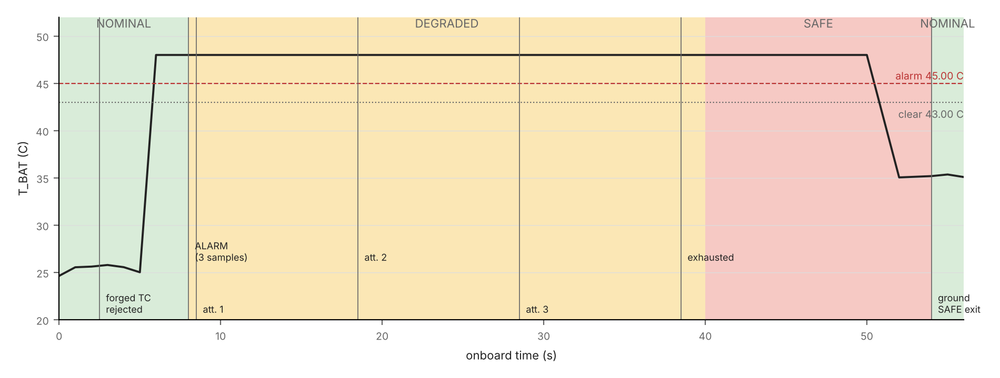

# 1. Introduction

## 1.1 Purpose

This report describes the flight software of LOTUS-1, a small Earth observation satellite in low Earth
orbit. The software was written over the program (Sessions 3 to 8) and integrated into one application
for the capstone. It runs on RTEMS 6 on a LEON3 processor, simulated with SIS, and on a host simulation
of the RTEMS API used for fast testing.

The software does five things:

- it runs a fixed-priority periodic task set;
- it exchanges CCSDS Space Packets with the ground using the ECSS PUS-C services;
- it monitors its own health and recovers from faults autonomously, within limits;
- it changes mode through a state machine generated from a model;
- it accepts only authenticated telecommands.

It is operated from a Yamcs mission control system through a ground security unit.

## 1.2 Scope

The report covers the integrated application under `src/`, the ground segment under `ground/` and
`mcs/`, and the verification evidence under `evidence/`. The `labs/` directories hold the history of
each session and are referenced, not described. Everything here can be rebuilt and rerun from the
repository: `make test` runs the host test levels, `make scenario` runs the mission scenario, and
`make sis` produces the target evidence.

## 1.3 What the reader will find

| Section | Content |
|---|---|
| 2 | The mission and the operational constraints that shape the software |
| 3 | 30 requirements in six areas |
| 4 | The task architecture, data flow and interfaces |
| 5 | The design of each area, with the key decisions and the reasons for them |
| 6 | How the software was verified: four test levels, coverage, static analysis, the validation campaign |
| 7 | The measured results of the demonstration scenario and the timing analysis |
| 8 | What is simulated, what is missing, and what a flight program would add |

Requirement identifiers (TIM-010, SEC-020, ...) are defined in Section 3. Evidence files are given as
repository paths. The demonstration recording is linked from the repository README.

# 2. Mission context

## 2.1 The reference mission

LOTUS-1 is a 12U demonstration satellite in a 520 km sun-synchronous orbit (period about 95 minutes).
It images coastal areas and river deltas on ground request.

> **Mission statement.** LOTUS-1 shall take images of a commanded target area during a planned pass and
> downlink them at the next ground contact. It shall stay safe and commandable between contacts without
> any ground action. It shall accept commands only from the LOTUS-1 control centre.

## 2.2 Constraints that drive the software

**Short, infrequent contacts.** One ground station sees the satellite 4 to 6 times a day, for about
8 minutes each time. The S-band uplink runs at 4 kbit/s. For more than 90 % of its life the vehicle is
alone, so:

- fault detection and the first recovery actions must be onboard (FDIR);
- the planned activities are carried by an onboard time-based schedule (PUS service 11);
- the safe state must be reachable autonomously, and stable for a day or more;
- leaving the safe state must be a ground decision.

**Operator workload.** A pass is short. Telemetry has to tell the operator what happened since the last
pass without being searched for. That means one event per fault (not one per sample), a cause attached
to every mode change, and verification reports for every command.

**Power and thermal.** The 28 V bus is simulated as `V_BUS`. Under voltage (below 26.0 V) threatens the
whole vehicle and is treated as critical. The battery temperature `T_BAT` and the OBC temperature
`T_OBC` are monitored. A battery that overheats can often be recovered by reducing load (heaters,
payload), so a thermal alarm is non-critical: the vehicle first degrades, tries a bounded number of
recoveries, and only then goes to SAFE.

**Payload.** The imager is represented by the PL_LOG task (about 100 ms of processing every second).
It runs only when the ground has asked for it and only in NOMINAL. It is the first load to shed.

**An open uplink.** Anyone with a transmitter on the uplink frequency can send a well-formed
telecommand. A CRC protects against noise, not against an adversary. Commands therefore carry a message
authentication code and a counter (Session 8), and the receiver must not help an attacker by answering
forged commands.

**Processor.** A LEON3 (SPARC V8) at 50 MHz under RTEMS 6. That is a few hundred times slower than a
desktop for the same code. SHA-256 is not free at this speed, which is why timing is a requirement area
of its own.

## 2.3 Modes

| Mode | Entered on | Payload | Telemetry | Schedule | Exit |
|---|---|---|---|---|---|
| NOMINAL | cold boot; ground command | runs if the ground enabled it | full HK SID 1 at 1 Hz | running | ground command or FDIR |
| DEGRADED | non-critical fault; ground command | suspended (enable kept) | full HK SID 1 | running | ground command only |
| SAFE | critical fault; recovery exhausted; watchdog reset; ground command | off, enable cleared | essential HK SID 2 every 2 s | suspended | authenticated ground command (procedure SAFE-01) |

## 2.4 The operational scenario

The demonstration (Section 7) follows one plausible day:

1. The vehicle boots to NOMINAL and HK reaches the MCS.
2. An authenticated command enables the payload.
3. A forged command (payload off, under a guessed key) arrives on the uplink and is rejected.
4. The battery overheats: one alarm, DEGRADED, payload suspended.
5. Three recovery attempts fail, so the vehicle goes to SAFE.
6. At the next pass the operators follow procedure SAFE-01 to bring it back to NOMINAL.

# 3. Requirements

The set has 30 requirements (`evidence/requirements.yaml`). It was built from the Session 7 validation
requirements and the Session 6 mode management requirements, cut to what the mission depends on. The
timing, security, thermal recovery and payload requirements were added for the capstone. Each
requirement records:

- its source (the mission need, then the design note that set the number);
- its verification method;
- the design section and the code that implement it.

The traceability matrix (`evidence/traceability-matrix.md`) is generated from these fields and from the
test outputs.

Methods: **T** test through the ground interface; **T-I** test at integration level, where the ground
cannot set up the condition deterministically; **A** analysis.

## 3.1 Timing

| ID | Requirement (abridged) | Method |
|---|---|---|
| TIM-010 | Every periodic task completes before its next release, with all tasks running, the worst blocking by the TC path, and a flood of rejected TCs at the uplink rate. Analysis gives each response time; the run on the target shows no missed period. | A, T |
| TIM-020 | Authenticating one TC, and rejecting one forged TC, each cost at most 5 ms of LEON3 time, so a TC flood at the S-band rate stays below 2 % of the processor. | A, T |

## 3.2 TM/TC

| ID | Requirement (abridged) | Method |
|---|---|---|
| TMTC-010 | An accepted TC is answered with TM(1,1) and, after execution, TM(1,7), as its acknowledgement flags request, carrying its request ID. | T |
| TMTC-020 | A TC failing an acceptance check is not executed and is answered with TM(1,2) giving the first failed check (checksum 3, APID 5, service 7, subtype 8, data 9). | T |
| TMTC-040 | TM(1,7) is sent only once the commanded function has taken effect. | T |
| TMTC-050 | Every TM packet passes the ground checks; per APID the sequence count advances by one per packet, and the TM drop counter stays 0. | T |
| TMTC-060 | In NOMINAL, HK SID 1 is generated every 1.0 s (each interval 0.9 to 1.1 s). | T |
| TMTC-070 | The flight build contains no fault injection service: TC(200,x) is rejected with code 7. | T |

## 3.3 Telecommand security

| ID | Requirement (abridged) | Method |
|---|---|---|
| SEC-010 | Every TC except a recovery command (SPI 0) carries a valid HMAC-SHA-256/128 trailer. A TC failing structure, CRC or MAC is not executed and gets no TM(1,x). | T |
| SEC-020 | A TC whose counter is not above the slot's last accepted counter, or is too far above it, is rejected as a replay, with no effect and no TM(1,x). The counter advances only on acceptance. | T |
| SEC-030 | Rejections are counted per class in SID 3. Security events are rate limited: one event for the first rejection of a class in a window, then a summary. | T |
| SEC-040 | A factory key store accepts nothing until a recovery command with the onboard challenge sets its counter floor. Scheduled TCs, authenticated at upload, are released without a trailer check. | T |

## 3.4 FDIR

| ID | Requirement (abridged) | Method |
|---|---|---|
| FDIR-010 | Fewer out-of-limit samples than the persistence raise nothing; the filtered count is reported. | T |
| FDIR-020 | A parameter out of limits for its persistence raises exactly one alarm event, within persistence + 1 sample periods. | T |
| FDIR-030 | Bus under voltage (V_BUS below 26.0 V for 3 samples) puts the vehicle in SAFE. | T |
| FDIR-040 | A supervised task that misses one heartbeat check is restarted, both reported, within 4.0 s. | T |
| FDIR-060 | If the supervisor stops, a watchdog warning is reported and the processor reset within 6 s; the vehicle boots in SAFE and reports why. | T |
| FDIR-070 | With no fault injected, no alarm, restart or mode change for 300 s. | T |
| FDIR-100 | In DEGRADED with a thermal alarm, at most 3 recovery attempts, 10 s apart, each reported; if the alarm clears, one RECOVERED event and the mode stays DEGRADED. | T |
| FDIR-110 | If the alarm persists after the last attempt, one EXHAUSTED event and SAFE (cause MONITOR) within 12 s; no new sequence before DEGRADED is left. | T |

## 3.5 Payload

| ID | Requirement (abridged) | Method |
|---|---|---|
| PL-010 | The payload is off at boot. It runs only while the ground has enabled it (TC(8,1) function 2) and the mode is NOMINAL. Enable and disable are reported with the commanded and effective states. | T |
| PL-020 | DEGRADED suspends the payload. SAFE switches it off and clears the enable. An enable outside NOMINAL is refused with TM(1,8) code 16. | T |

## 3.6 Mode management

| ID | Requirement (abridged) | Method |
|---|---|---|
| MM-010 | SAFE and DEGRADED are exited only by ground telecommand. | T |
| MM-020 | Entry to SAFE suspends the schedule; leaving SAFE does not resume it. | T |
| MM-030 | Entry to SAFE switches the payload off, reduces TM to essentials, tightens monitoring, commands sun pointing and keeps the receiver on. | T |
| MM-040 | With FDIR not inhibited, a confirmed critical fault commands SAFE and a non-critical fault DEGRADED, from any less severe mode. | T |
| MM-050 | No autonomous event lowers the mode; a parameter returning inside limits does not cause recovery. | T |
| MM-080 | Every mode transition is reported with its cause and detail. | T |
| MM-090 | Cold boot starts in NOMINAL, a watchdog reset in SAFE, with no transition report at boot. | T |
| MM-150 | A ground mode command takes effect, and is reported, within 3.0 s of its TM(1,7). | T |

# 4. Architecture

## 4.1 Overview

The flight software is one RTEMS application built from `src/`, in four layers:

- **`core/`**: CCSDS Space Packets, CRC-16, PUS-C headers and the TC handler. No RTOS calls.
- **`fdir/`**: limit monitors, liveness supervisor, watchdog model, non volatile boot record, schedule,
  thermal recovery, and the generated mode machine. No RTOS calls except `fdir.c`, which binds them to
  the application.
- **`security/`**: MAC check, anti-replay, key store, key management service and rejection reporting,
  plus `security.c`, which binds them to the application.
- **`app/`**: RTEMS configuration and tasks, the UART TM/TC tasks, the PUS service handlers and the
  sensor model.

Keeping RTOS calls out of the first three layers was a decision made in Session 4, before testing was
on the agenda. It is why every core module now has host unit tests with no stubs. The application layer
is tested from integration level up, where the host simulation (`src/sim/`) provides the RTEMS API on
POSIX threads.

## 4.2 Tasks

| Task | Priority | Period | Work | Measured or budgeted C |
|---|---:|---|---|---:|
| SUP | 5 | 2000 ms | liveness check, inhibit expiry, mode machine step, NV write, watchdog kick | 5.0 ms (allowance) |
| ACS_CTRL | 10 | 100 ms | attitude control stand-in | 18.96 ms (SIS) |
| TM_HK | 20 | 500 ms | sampling, monitors, thermal step, HK, security HK and key scrub | 50.35 ms |
| PL_LOG | 30 | 1000 ms | payload processing, only when `payload_on` | 95.64 ms (SIS) |
| TC_RX | 40 | aperiodic | security check, TC handler, services | 2.0 ms per TC |
| SCHED | 45 | 1000 ms | releases due time-tagged commands | 4.6 ms (allowance) |
| TM_TX | 50 | aperiodic | downlink of every packet | under 1 ms per packet |
| WDOG | ISR | 100 ms | watchdog model (timer service routine) | tiny |

Rate monotonic order for the periodic tasks, with two deliberate exceptions:

- **SUP at the top**, although its period is the longest. The supervisor detects tasks that stop
  running. If a busy higher-priority task could delay it, the supervisor would be blind to exactly the
  overload it exists to detect. Its cost (about 5 ms every 2 s) is tiny.
- **TC_RX below the periodic tasks** (except SCHED). A burst of uplink frames, valid or forged, then
  costs only slack time. The price is command latency, which is irrelevant at 4 kbit/s. SCHED sits below
  TC_RX so a ground command is handled before a stored one.

## 4.3 Shared resources

Three binary semaphores with priority inheritance protect the shared state:

| Lock | Protects | Taken by |
|---|---|---|
| tc lock | the TC handler and services, schedule release | TC_RX, SCHED |
| mode lock | mode machine, payload state, inhibit | services, SUP, TM_HK (FDIR cycle) |
| event lock | the event report sequence (one counter, one order on the downlink) | anything that emits an FDIR event |

The order is always tc, then mode, then event (`src/app/tmtc.h`). It was checked by reading every lock
call, and IT-11 runs the TC_RX and SCHED paths concurrently. Priority inheritance came from Lab 3.3. Here is the case
it prevents. SCHED (45) releases a stored mode command and holds the mode lock. TM_HK (20) then blocks
on that lock, and PL_LOG (30) pre-empts SCHED for up to 100 ms. Without inheritance, TM_HK would wait for
all of PL_LOG. With it, SCHED runs at priority 20 until it releases the lock, and TM_HK waits only for
the critical section, which is the B term of Section 5.1.

## 4.4 Data flow and interfaces

| Interface | Direction | Format | Where |
|---|---|---|---|
| UART (SIS console, or a pseudo-terminal on the host) | TC in | one hex line per CCSDS TC, with the 21-octet security trailer | `app/tmtc.c` |
| UART | TM out | one hex line per CCSDS TM; APIDs 0x010 (TM(1,x), TM(17,2)), 0x020 (HK), 0x021 (FDIR events), 0x022 (security HK and events) | `app/tmtc.c` |
| Non volatile memory | both | boot record (CRC protected) and key store (three copies per item) | `fdir/nvstate.c`, `security/security.c` |
| Ground security unit (bridge) | both | TCP to Yamcs (10015 TM, 10025 TC); raw uplink port 10026 for the forged-command demonstration | `mcs/bridge/sc_bridge.py` |

One telecommand goes through these steps:

1. TC_RX reads a line and decodes it.
2. It takes the tc lock and runs the security check (structure, CRC, MAC, freshness).
3. The service's semantic check runs, the counter is committed, and the TC executes.
4. The verification reports go to TM_TX through the message queue `TMQ1`.

Scheduled commands enter at step 3 (Section 5.5).

# 5. Design

## 5.1 Timing and scheduling

**Model.** Fixed-priority pre-emptive scheduling with rate monotonic periods. The task set is the Lab 3.2
one (ACS_CTRL, TM_HK, PL_LOG) plus the FDIR tasks (SUP, SCHED) and the aperiodic TM/TC tasks. One clock
tick is 10 ms.

**Analysis.** Response time analysis with blocking:

$$R_i = C_i + B_i + \sum_{j \in hp(i)} \left\lceil \frac{R_i}{T_j} \right\rceil C_j$$

B is the longest critical section of a lower-priority task under a lock the task may need. The longest
is a key load, TC(210,1), under the tc lock: accept plus unwrap, 4.16 ms by estimate. It applies to every
task at priority 20 or below.

**This is the fourth budget, and the one that counts.**

- Session 3: three tasks, from a work loop.
- Session 4: measured on SIS; total U = 0.381.
- Session 8: added the security costs to TM_HK (key scrub, SID 3), and TC_RX under a flood.
- Capstone: all the above together, plus SUP and SCHED, for which no measurement existed (design
  allowances of 5 ms and 4 ms).

The integrated estimate closes. U = 0.393 against a Liu and Layland bound of 0.744 for five tasks, and
every R ≤ T (Table 7.3). The SIS run of the integrated timing build replaces the estimate with measured
values: `make sis` writes `evidence/timing/budget-sis.md`.

**What happens at 1.3 times the expected load.** Multiplying every C by 1.3 gives U = 0.51, still under
the bound. PL_LOG's response time grows from 193 ms to about 274 ms against a 1000 ms deadline. The
control loop is the last to suffer: only SUP can pre-empt ACS_CTRL, so it misses only if its own C
grows towards 100 ms. The task set fails gracefully: the lowest-priority periodic work (PL_LOG, then SCHED)
misses first. SUP sees the missed heartbeat (FDIR-040) and the payload is the first load to shed. This
is the main argument for rate monotonic priorities with the payload at the bottom.

## 5.2 TM/TC

**PUS-C over CCSDS.** Space Packets with the PUS-C secondary header and a CRC-16/CCITT trailer. The
services are:

- 1, request verification;
- 3, housekeeping;
- 5, events;
- 8, function management (mode, payload);
- 11, time-based schedule;
- 12, monitoring control;
- 17, test;
- 19, FDIR inhibit;
- 200, fault injection (test build only);
- 210, key management.

**Validate before you act.** The handler runs the acceptance checks in a fixed order: length and
version, checksum, APID, service, subtype, then the service's own data check. Only a TC that passes
every one is executed. The order goes from the cheapest and most general check to the most specific.
A corrupted packet is rejected before its fields are trusted, so a service handler never sees data from
a packet with a bad CRC.

With security (Section 5.5) the order becomes:

structure → CRC → MAC → freshness → semantic → commit → execute.

- **CRC before MAC**, because noise is far more common than attack and the CRC is cheap: the whole
  path of a plain TC costs about 0.55 ms on LEON3, the MAC alone 1.44 ms (estimates, Section 7.3).
- **MAC before freshness**, because an unauthenticated counter must not be compared with, or update, the
  stored one. Otherwise forged packets with high counters could lock out the real ground.
- **Commit after the semantic check**, so a command the service refuses does not consume its counter
  value.

**Reports.** TM(1,1) on acceptance, TM(1,7) on completion and TM(1,2)/(1,8) on failure, as the
acknowledgement flags request. One known deviation is recorded as NCR-01 (deferred). A mode command's
TM(1,7) is sent when the request is posted to the mode machine, up to 2 s before the mode changes. The
workaround is in the MCS: SET_MODE completes only when HK shows the mode.

**Downlink.** All TM goes through one queue (`TMQ1`, 48 packets) to TM_TX, the lowest-priority task.
The queue is sized for the worst burst (boot report, HK, events and a full schedule dump). The drop
counter in HK has stayed at 0 over every validation run (TMTC-050).

## 5.3 FDIR

The FDIR uses three detection mechanisms and one escalation ladder.

**Limit monitors** (Lab 5.1). Each parameter has a low and high alarm limit, a clear limit inside each
(hysteresis), and a persistence (consecutive samples).

| Parameter | Alarm low / clear | Alarm high / clear | Persistence | Fault class |
|---|---|---|---|---|
| V_BUS | 26.0 V / 26.3 V | 29.5 V / 29.2 V | 3 | low: critical (SAFE); high: non-critical |
| T_BAT | 0.00 °C / 2.00 °C | 45.00 °C / 43.00 °C | 3 | non-critical (DEGRADED, then thermal recovery) |
| T_OBC | −20.00 °C / −15.00 °C | 70.00 °C / 65.00 °C | 5 | non-critical |

Persistence filtering is how false alarms are controlled. A single bad sample is counted in HK
(`monitor_filtered`) and has no other effect. VT-FDIR-070 runs 300 s with sensor noise and no injected
fault, and asserts zero events. The clear limits stop an alarm from chattering around its limit.

**Liveness supervision** (Lab 5.2). ACS_CTRL, TM_HK and PL_LOG each post a heartbeat. SUP checks them
every 2 s:

- a missed heartbeat restarts the task;
- three restarts within 300 s escalate (ACS or HK to SAFE, PL_LOG to DEGRADED).

SUP kicks the watchdog only after its own check, and the watchdog resets the processor if no kick
arrives within 5 s.

**Where the chain ends.** The tasks are watched by the supervisor, and the supervisor by the watchdog.
The watchdog is a timer service routine driven by the clock interrupt. It stands for a hardware watchdog,
which on a flight OBC is an independent counter that software can only restart, not stop. The endpoint
is trustworthy because it shares nothing with what it watches except the clock: no task, no lock and no
queue. Its action (reset into SAFE, with the cause in NV memory) works even if the whole task set is
dead. On SIS it is a simulation of that hardware, which Section 8 states as a limitation.

**Thermal recovery (new for the capstone).** In DEGRADED with a T_BAT or T_OBC alarm, the FDIR makes up
to three recovery attempts, 10 s apart. Each attempt is reported with the current value. On a real
vehicle an attempt would switch heaters off and shed payload power. Here it is reported and the
temperature re-checked. The outcomes are:

- **The alarm clears.** Recovery stops with one RECOVERED event. The vehicle stays in DEGRADED, because
  only the ground lowers the mode (MM-050).
- **The alarm persists after attempt 3.** EXHAUSTED is reported and SAFE is requested with cause
  MONITOR.

A "spent" latch prevents a second sequence before DEGRADED is left. Unit testing found that this latch
was missing (NCR-03, Section 6.5).

**Bounded escalation.** Every recovery in the system is bounded: three restarts per task per 300 s,
three thermal attempts, one watchdog reset into SAFE. Nothing retries forever, and every bound ends in
a state the ground can see and leave.

## 5.4 Mode management

**One machine, generated from a model.** The three-mode machine is defined in `model/mode_machine.yaml`:

- 12 transitions with guards, priorities and actions;
- the inputs: six events and the FDIR inhibit flag;
- explicit "ignore" entries for every (mode, event) pair with no transition.

`model/modelgen.py` generates `src/fdir/mode_sm.c`, a trace file, and a completeness report that proves
every pair is handled or ignored (MM-100). CI regenerates the code and fails if it differs from the
committed file (`make check-generated`). Session 6 showed the generated machine equivalent to the
hand-written Session 5 one on every requirement trace. The hand-written one was deleted at integration
(Section 4, duplicates).

**Cyclic evaluation.** Events are posted at any time, under the mode lock, and marked pending. The
machine steps once per supervisor cycle (2 s), in SUP. It runs in SUP, not in TM_HK, because a step
inside TM_HK would stop when TM_HK hangs, which is one of the faults it must handle. The cost is up to
2 s of latency. That is accepted and bounded by MM-150 (3.0 s), and it is the cause of NCR-01.

**Why SAFE does not exit automatically.** SAFE is entered because something the software could not fix
happened. The software that decided to enter SAFE is the same software that would decide to leave it.
An automatic exit would need a condition proving the cause is gone, and the essential telemetry in SAFE
is deliberately thin (OBS-02). A temperature back inside its limits says nothing about why it left them.
A vehicle that cycles between NOMINAL and SAFE without anyone noticing is worse than one that waits in
SAFE for a pass. SAFE is stable, power positive and sun pointing, so waiting costs only mission time.
MM-010 makes this a requirement, and the model has no autonomous transition out of SAFE or DEGRADED.

**Priority policy.** When several transitions are enabled in one cycle, the lowest priority number wins:
SAFE first, then ground commands, then autonomous DEGRADED, then refusal reports. Two ground commands in
the same cycle resolve to the more conservative mode. A fault confirmed in the same cycle as a ground
recovery is not lost (MM-130, verified at integration level).

## 5.5 Telecommand security

**Scheme.** Every TC carries a 21-octet trailer before its CRC:

- SPI: which key slot (1 octet);
- a 32-bit counter;
- the first 16 octets of HMAC-SHA-256 over the whole packet up to the counter.

The packet length counts the trailer, so a Session 4 parser still sees a valid packet. HMAC-SHA-256 comes
from tinycrypt, vendored with its version recorded. The ground uses Python's `hmac`, an independent
implementation; the two agree in the unit tests and in every system test.

**Freshness by counter, not time.** The onboard clock restarts at every boot, so a timestamp would be
useless for freshness. A counter that only the accepted command advances survives clock resets. A
counter more than 65 536 ahead of the stored one is rejected (WINDOW), never jumped to. This stops one
forged-but-guessed value from burning the counter space.

**No oracle.** A TC rejected before authentication gets no TM(1,2). An attacker learns nothing per packet.
The operator learns everything from SID 3, which counts rejections per class, and from rate-limited
events: one REJECT_FIRST per class, then a REJECT_SUMMARY per 10 s window. In the Session 8 flood test,
400 forged TCs of four classes produced 8 events, and the summaries account for every one.

**Keys** (Lab 8.2). Slot 0 holds the recovery key (ROM); slots 1 and 2 hold the operational keys.

- A new key is uploaded wrapped (AES-128-CCM under a ROM key-encryption key, bound to its slot) into the
  inactive slot.
- The ground checks its key check value in SID 3, then activates it. The old key remains as a fallback.
- Keys, counters and the recovery challenge are each stored three times. They are voted on read and
  scrubbed once a second.

**If the onboard key is corrupted.**

- One copy wrong: the scrub repairs it (event KEY_REPAIRED).
- Two copies wrong: the slot is marked CORRUPT and commands under it fail with AUTH. The operator sees
  this in SID 3 and the KEY_CORRUPT event. The operator then sends RECOVERY_ACTIVATE under the recovery
  key, with the one-time challenge read from SID 3, to switch to the loaded spare slot.
- Counter corrupted high, so every command looks like a replay: RECOVERY_SET_COUNTER sets a floor above
  every value the ground ever used.

The recovery commands can do only these two things. They cannot change mode, load keys or command the
payload. Every use is reported. This is contingency C-SEC of procedure SAFE-01.

**First contact.** A factory key store (or one whose counter cannot be trusted after NV loss) accepts
nothing until a recovery command sets the floor. This closes the replay window that a blank counter would
otherwise open (Session 8 risk R-02). It also makes the first contact an explicit step of the
procedures.

**Scheduled commands.** The schedule releases stored commands without the trailer check. They were
authenticated when TC(11,4) uploaded them, and re-checking them would fail anyway: their counters are
older than everything sent since.

**Ground side.** Yamcs never holds a key. The bridge is the ground security unit: it signs, counts, and
generates and wraps new keys. LOAD_KEY in the MDB carries only a slot number. All service 210 commands
are "critical" and wait in a supervised queue for a second operator.

# 6. Verification and validation

## 6.1 Test architecture

| Level | Pairs with | What runs | Environment | Result |
|---|---|---|---|---|
| Static | implementation | GCC maximum warnings with `-Werror` (both builds); clang `-Weverything`; cppcheck with the MISRA C:2012 addon; clang analyser; GCC `-fanalyzer` | host | @@STATIC_SUMMARY@@ |
| Unit | detailed design | 9 Unity suites, one per core module (sp, pus, monitor, liveness, schedule, mode_sm, thermal, keystore, tc_auth) | host, no RTOS | @@UNIT_SUMMARY@@ |
| Integration | architecture | `int_tc_path`: the real handler, services, security, FDIR and mode machine linked together, with TM captured at the sink; 16 cases | host simulation of RTEMS; RTEMS 6 on SIS | @@INT_SUMMARY@@ |
| Validation | requirements | @@VAL_COUNT@@ cases through the ground interface only, on the test and the flight build; 11 spacecraft runs | host simulation; SIS (nightly job) | @@VAL_SUMMARY@@ |
| Scenario | mission | the 7-step demonstration, automated (`demo/scenario.py`) | host simulation in CI; SIS | @@SCEN_SUMMARY@@ |

Each defect class is tested in the cheapest environment that can show it:

- logic on the host, in milliseconds;
- interfaces in the simulation, in under a second;
- requirements through the ground link, in about 10 minutes.

`make test` runs the host levels. The CI job `fast-checks` runs warnings, unit, integration, static
analysis, coverage, MC/DC, the model check, the MDB check and the scenario on every push. The nightly
job builds the RTEMS toolchain (cached) and runs the target levels on SIS.

## 6.2 Coverage

gcov from GCC 13, cumulative over unit, integration and validation, on the integrated sources
(`evidence/coverage/coverage.md`).

@@COVERAGE_TABLE@@

**What is in the uncovered remainder.** Every flight line not executed by any level is classified in
`evidence/coverage/justifications.yaml`, and the report fails on an unclassified line. The remainder is:

- **Defensive code** for failures the test environment cannot produce. Examples are an RTEMS object that
  fails to create, a console write error, a full TM queue, and a corrupted state value reaching the mode
  machine's default branch. Each entry argues why the path is unreachable in test and what it does in
  flight.
- **Code not in the flight build**: the fault injection service, and the mode machine's name tables used
  only in unit test builds.
- **Boot failure paths** whose inputs are compile-time constants.

**MC/DC.** It is measured with clang 18 on the guard conditions of the monitor, the supervisor and the
generated mode machine (`evidence/coverage/mcdc.md`). A mutation check replaces each condition with `1`
and reruns the unit tests: 9 of 10 mutants are killed. The survivor is an equivalent mutant. In the mode
machine, T05's `fdir_inhibited` condition can never be false when it is evaluated, because T02 has
higher priority and fires on exactly that case. The guard is kept as written so that it reads like the
model and stays correct if the priorities change.

## 6.3 Static analysis

@@STATIC_TABLE@@

Every finding is matched to a disposition in `evidence/static-analysis/dispositions.yaml`:

- **fixed**: the finding must not reappear;
- **justified**: the code is right, with the argument why;
- **accepted**: a deliberate deviation, with its risk.

A finding without a disposition fails the CI job. The accepted deviations (from the cppcheck MISRA run)
are mostly advisory rules: the RTEMS configuration macros, single exit points, and the mixed-width
arithmetic of the packet code. The 57 findings in this run are all justified. Most are clang
`-Weverything` style warnings, for example a default label in a switch that covers every enumeration
value, which MISRA rule 16.4 requires.

## 6.4 Validation campaign

The campaign drives the complete application through the ground interface only: TC lines in, TM lines
out, decoded by an independent ground codec. It does what an operator could do, and nothing more.
Fault injection (service 200, test build only) sets up the faults. The specification
(`evidence/validation/test-spec.md`) is generated from the same data the campaign executes, so it
cannot drift from the tests.

@@VAL_TABLE@@

## 6.5 What integration broke that unit testing did not catch

Integration found six problems (`evidence/ncr-log.md`). A sixth, TA-07, was my own expectation being wrong: a test assumed a counter with one bad copy would raise a vote event, but two agreeing copies are a majority and the repair is silent, by design.

- **The first contact ate the boot event** (TA-04). The secure link performs a recovery command on the
  first boot of a factory key store, and that exchange consumed the boot event the first validation test
  waits for. Each part was right on its own. Together they hid MM-090's evidence.
- **Security HK decoded as FDIR HK** (TA-05). The campaign selected HK by service and subtype. The
  integrated build added a second (3,25) stream on another APID, so the selection had to include the
  APID.
- **Test order dependency** (TA-06). The payload test left the vehicle in SAFE, which suspends the
  schedule (MM-020). The next test then found the schedule correctly stopped.
- **NCR-01, still deferred.** It is an integration defect by nature: the Session 4 service contract
  ("TM(1,7) when exec returns") met the Session 6 cyclic mode machine.
- **The thermal recovery re-triggered** (NCR-03, major, fixed). This one was found by a unit test
  written against the integrated timing. EXHAUSTED requests SAFE, but SAFE is applied at the next 2 s
  supervisor cycle. In between, the next HK cycle saw "DEGRADED with an alarm" and started a second
  sequence. The fix is the "spent" latch.

- **Helper names repeated across files** (NCR-05, minor, fixed). The first CI run of the integrated
  tree failed. cppcheck's whole-program MISRA check found static helpers with the same name in
  different files (`put32`, `event`, `persist`, ...), and no per-lab analysis could have seen that.

None of these is visible to a module tested alone. Each comes from two correct components meeting a
timing or an assumption they did not share.

## 6.6 Non-conformances

| ID | Kind | Requirement | Severity | Status |
|---|---|---|---|---|
| NCR-01 | NCR | TMTC-040 | minor | deferred: TM(1,7) for a mode command precedes the transition by up to 2 s; MCS workaround |
| NCR-02 | NCR | TMTC-030 | minor | fixed: an over-long line was dropped uncounted |
| NCR-03 | NCR | FDIR-110 | major | fixed: second thermal recovery sequence after EXHAUSTED |
| NCR-04 | NCR | SEC-020 | major | **open**: on SIS the key store is RAM, so counters do not survive a reset |
| NCR-05 | NCR | MISRA 5.9 | minor | fixed: static helper names repeated across files, found by the first CI run of the integrated tree |
| OBS-03 | OBS | (static analysis) | | **open**: 12 cppcheck findings in files never analysed by cppcheck before, not yet triaged |
| OBS-01 | OBS | (FDIR-120 candidate) | | **open**: ground can return to NOMINAL while an alarm is still active, with no reminder |
| OBS-02 | OBS | MM-030 | | **open**: SID 2 (SAFE) has no monitor states |
| TA-01 to TA-07 | test anomalies | | | fixed (the test was wrong; no flight code changed) |

Open items stay open. NCR-04 cannot be closed on SIS. It needs the NV driver of a real OBC. Until then,
the mitigation is that any reset leaves the counter untrusted and needs a recovery command with a fresh
challenge.

# 7. Results

## 7.1 The demonstration scenario

The scenario was run automatically (`demo/scenario.py`, host simulation; log and JSON in
`evidence/demo/`) and through Yamcs for the recording (`demo/run_demo.py`). The measurements below are
in onboard time, from the automated run.

| Step | What happened | Measured |
|---|---|---|
| 1 | Boot to NOMINAL, HK SID 1 to the ground, payload off | first HK at boot; boot report: cold, NV blank |
| 2 | PAYLOAD ON, authenticated | TM(1,1) then TM(1,7), 1 ms round trip on the host; HK shows enabled and running |
| 3 | Forged PAYLOAD OFF (wrong key) on the raw uplink | no TM(1,x); one REJECT_FIRST (AUTH, code 10); SID 3 AUTH +1; payload still ON |
| 4 | T_BAT forced to 48.00 °C | one ALARM event 3.00 s after injection (3 samples at 1 Hz); DEGRADED in the same cycle; payload suspended, enable kept |
| 5 | 3 attempts, exhausted, SAFE | attempts at +0.5, +10.5, +20.5 s after DEGRADED; EXHAUSTED at +30.5 s; SAFE 35.0 s after injection; schedule suspended; SID 2 only, every 2 s; PAYLOAD ON refused (TM(1,8)) |
| 6 | SAFE-01: assess, clear, authenticated exit | cause MONITOR, T_BAT 48.00 °C in SID 2; after the clear, 35.05 °C; SAFE → NOMINAL 2.00 s after TM(1,7) (MM-150: ≤ 3.0 s) |
| 7 | CI and coverage for the same commit | fast-checks job (badge on the README); `evidence/coverage/coverage.md` |

All 24 checks of the automated scenario pass. Each of the six security, thermal and payload
behaviours is also a validation test (VT-SEC-010, VT-FDIR-100, VT-PL-010), so they are checked
independently of the demonstration.

## 7.2 Detection latencies

| Fault | Requirement | Bound | Measured (host simulation, validation) |
|---|---|---|---|
| T_BAT over limit, alarm event | FDIR-020 | ≤ 4.0 s | 2.995 s after TM(1,7) of the injection |
| V_BUS under voltage, SAFE | FDIR-030 | (3 samples + 1 cycle) | 3.998 s |
| Task hang, restart | FDIR-040 | ≤ 4.0 s | 3.999 s |
| Supervisor hang, watchdog reset | FDIR-060 | ≤ 6 s | warning at 5.498 s, then reset into SAFE |
| Thermal recovery attempts | FDIR-100 | 10 ± 0.5 s apart | 10.0 s, 10.0 s |
| Ground mode command, transition | MM-150 | ≤ 3.0 s after TM(1,7) | 2.00 s |

## 7.3 Timing

@@TIMING_TABLE@@

The estimate uses the Session 4 SIS measurements for ACS_CTRL, TM_HK and PL_LOG, the security costs from
calibrated instruction counts, and allowances for SUP and SCHED. On SIS, `make sis` measures every
periodic task in the integrated flight build over 60 s (rate monotonic statistics, missed periods) and
every security operation, and regenerates the table with the comparison.

**Security cost.** Authenticating one 120-octet TC costs an estimated 2.0 ms on LEON3 (1.44 ms of it is
the MAC). Rejecting a forgery costs 1.8 ms. Both are within TIM-020's 5 ms. At the S-band uplink rate
(3.9 TC/s at most) a flood of forgeries costs 0.7 % of the processor. On the lab console (47 TC/s) it
costs 8.6 %, and the task set still closes.

# 8. Limitations and future work

A four-month project cannot produce flight-qualified software. This section says what LOTUS-1 is not,
as precisely as possible.

## 8.1 What is simulated

- **No real hardware.** The processor is SIS, an instruction-level LEON3 simulator. Its timing comes from
  a cycle model with no caches, no bus contention and no wait states on memory, so the measured
  execution times are optimistic. Real LEON3 boards with caches and SDRAM can be several times slower on
  memory-bound code such as SHA-256. Development and most tests use a host simulation of the RTEMS API
  on POSIX threads. Its scheduling is not RTEMS's (Linux threads, no strict priorities), so timing
  results from the host are meaningless and only SIS figures are used for timing.
- **Emulated timing.** SIS with `-rt` follows wall-clock time. Timing on a loaded host can stretch an
  interval, which is why validation tolerances are ±0.1 s, not ±1 ms.
- **Sensors.** V_BUS, T_BAT and T_OBC come from a model (noise around a nominal value) and from fault
  injection, not from an ADC. No sensor failure modes (stuck-at, open circuit, drift) are modelled.
- **No orbit or environment model.** There is no orbit propagation, eclipse, or thermal model. A ground
  contact is "the link is up". The thermal recovery attempt changes nothing physical. Sun pointing in
  SAFE is a status bit.
- **Watchdog.** A timer service routine stands in for an independent hardware watchdog. It runs on the
  same clock interrupt as the RTOS, which a real watchdog would not.
- **Non volatile memory.** A file on the host; RAM on SIS. That is NCR-04: on SIS the key store counters
  do not survive a reset.
- **The link.** A UART carrying hex lines. There is no CCSDS TC transfer frame, COP-1 or CLTU, and no
  bit errors beyond the noise the tests inject.

## 8.2 What was not implemented

- **No radiation effects** beyond the key store's triple copies and scrub: no EDAC on code or data
  memory, no memory scrubbing, no single event latch-up handling. A bit flip in the mode variable is
  handled by the mode machine's default branch (to SAFE), but nothing else is protected.
- **No redundancy management.** One processor, one of everything. No cross-strapping, no warm or cold
  spare, no failover.
- **No software update or patching path**, and no image integrity check at boot.
- **No onboard time management** (PUS 9), no time correlation, no file transfer, no payload data
  handling beyond a CPU load.
- **The authentication scheme has not been independently reviewed.** It follows the structure of the
  CCSDS Space Data Link Security protocol (SDLS) but is not SDLS: it sits inside the Space Packet, not
  in the transfer frame. It has no encryption: commands are authenticated, not confidential. Keys are
  lab keys committed to the repository. The design and the threat analysis (`labs/session-08`) are my
  own. No cryptographer or security assessor has reviewed them.
- **Not developed to a standard.** The code follows ECSS-E-ST-40C and MISRA C:2012 in spirit
  (requirements, traceability, coverage, static analysis with dispositions). It has no software
  development plan, no independent verification, no formal reviews and no configuration control beyond
  git. MC/DC is measured on selected guards only, not on the whole code as DO-178C level A or
  ECSS category A would require.

## 8.3 Weakest part

The weakest part is **non volatile state across resets**. Two of the most important properties depend on
it:

- the anti-replay counter (SEC-020);
- the boot cause, which decides whether the vehicle boots into SAFE after a watchdog reset (MM-090).

Neither has a real implementation on the target: a file on the host, RAM on SIS. The design (three
copies, voting, a CRC-protected boot record, an untrusted state after loss) is sound on paper. It has
never been run against real flash with its write times, wear, and partial writes on power loss. That is
the first thing a flight program would have to build and test.

## 8.4 Next steps, in order

1. Port to a real LEON3 board (GR712RC or a GR-CPCI-LEON3) and re-measure the timing budget with caches
   and real memory.
2. Implement the NV driver (two banks, write with read-back, versioned records) and close NCR-04.
3. Fix NCR-01: a "completion pending" result in the TC handler, with TM(1,7) sent by the mode machine's
   transition hook.
4. Answer OBS-01 and OBS-02 with the operations team: a reminder event when ground de-escalates over an
   active alarm, and monitor states in SID 2.
5. Move authentication to SDLS at the transfer frame level, have it reviewed, and generate keys in
   a hardware security module on the ground.
6. Add EDAC and memory scrubbing, and a fault-injection campaign on SIS with memory upsets.

# 9. References

1. ECSS-E-ST-70-41C, *Telemetry and telecommand packet utilization* (PUS-C). ESA-ESTEC, 15 April 2016.
2. CCSDS 133.0-B-2, *Space Packet Protocol*. Blue Book, June 2020.
3. CCSDS 355.0-B-2, *Space Data Link Security Protocol*. Blue Book, July 2022.
4. ECSS-E-ST-40C, *Software*. ESA-ESTEC, 6 March 2009.
5. ECSS-Q-ST-80C Rev.1, *Software product assurance*. ESA-ESTEC, 15 February 2017.
6. MISRA C:2012, *Guidelines for the use of the C language in critical systems*, third edition, first
   revision. MISRA, 2019.
7. RFC 2104, *HMAC: Keyed-Hashing for Message Authentication*. IETF, 1997. FIPS 180-4, *Secure Hash
   Standard*. NIST, 2015.
8. C. L. Liu and J. W. Layland, "Scheduling algorithms for multiprogramming in a hard-real-time
   environment", *Journal of the ACM* 20(1), 1973.
9. N. Audsley, A. Burns, M. Richardson, K. Tindell, A. Wellings, "Applying new scheduling theory to
   static priority pre-emptive scheduling", *Software Engineering Journal* 8(5), 1993.
10. RTEMS 6 Classic API Guide and BSP guide (LEON3). rtems.org. SIS, the SPARC instruction simulator,
    as built by the RTEMS Source Builder 6.1.
11. Yamcs 5.13 documentation (XTCE MDB, PUS verifiers, command queues). yamcs.org.
12. tinycrypt, Intel, BSD-3-Clause (SHA-256, HMAC, AES-128-CCM). Unity test framework, ThrowTheSwitch.
    gcov (GCC 13.3), gcovr 7.2, clang/llvm 18 (MC/DC), cppcheck 2.13 with the MISRA addon.

**Repository map.** `src/` the application; `model/` the mode machine model and generator; `ground/`
the ground codec and security unit; `mcs/` Yamcs configuration, MDB, displays and procedures; `tests/`
all test levels; `evidence/` the evidence set (start at `evidence/README.md`); `demo/` the scenario;
`docs/` architecture, mission and this report; `labs/` the history of each session.
