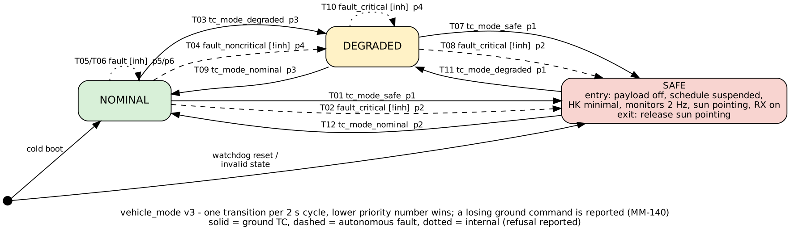
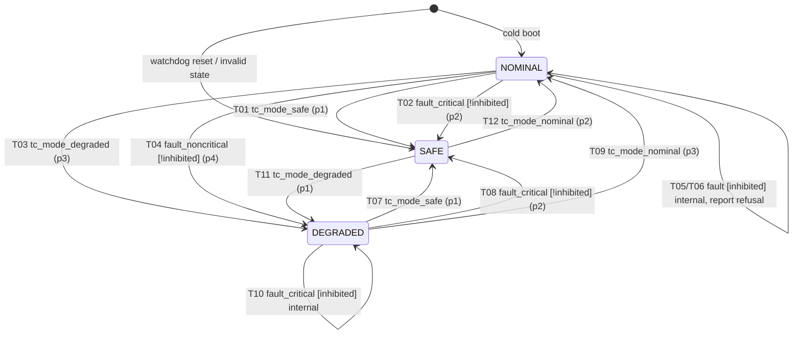

# Session 6 - Model-based development

The Session 5 mode manager (`session-05/lab-5.3-safe-mode/modes.c`) is rebuilt from an explicit model:

- the model is turned into C by a generator (Path B: YAML model and my own Python generator);
- the generated code is compared back to back with the hand written version;
- requirements are traced down to generated lines and tests;
- the generated module flies in the Session 5 application in place of `modes.c`.

Report: [`docs/mbd-report.md`](docs/mbd-report.md).

| Lab | Folder | Deliverables |
|---|---|---|
| 6.1 | `lab-6.1-model/` | `mode_machine.yaml` (model), `semantics.md`, `ambiguities.md`, `completeness.md` |
| 6.2 | `lab-6.2-generation/` | `modelgen.py` (generator), `generated/` (do not edit), generator tests, static analysis, system test logs |
| 6.3 | `lab-6.3-equivalence/` | `b2b.c` (harness), `sequences/`, `divergence-log.md`, `results/coverage.md`, `req_tests.c` |
| 6.4 | `lab-6.4-traceability/` | `requirements.yaml` (MM-010 to MM-150), `traceability.md`, derivation note in `README.md` |
| - | `app/` | Session 5 application with the generated mode manager (`fdir6.c`) |

## State machine (`vehicle_mode` v3)



Source: `docs/mode-state-machine.dot`. The same machine as Mermaid:



Lower priority numbers win. At most one transition fires per 2 s supervisor cycle, and only ground commands leave SAFE or DEGRADED.

## Results

| Check | Result |
|---|---|
| Completeness: (state, event) pairs | 18: 9 handled, 9 ignored, 0 unhandled |
| Generator negative tests | 11/11 |
| GCC strict warnings / clang-tidy on generated code | 0 / 0 (36 before the generator fix) |
| Back to back, single-event cycles | 0 of 7996 diverge (502 in run 1, D-01, model fixed) |
| Back to back, multi-event cycles | 998 of 2730 diverge, all classified (D-02 to D-06); D-05 losing commands reported since v3 |
| MM-150 latency (TM(1,7) to mode report) | max 1.999 s, limit 3.0 s |
| Requirement tests | 17/17 (TC-GND-02 for MM-140 fails on the v2 code, as intended) |
| Coverage of `mode_sm.c` (flight code) | 100 % statements; 94.7 % branches, 3 unreachable by construction and argued |
| Traceability | 15 requirements, 0 gaps |
| Session 5 system scenarios on the generated build | check_flight 11/11; campaign 6/6 and 0 false positives in 300 s; gs_modes 49/51 (D-07) |

## Running

Needs Python 3 with PyYAML, GCC and gcov; clang-tidy for the static check.

```
make test           # Lab 6.2 checks, Lab 6.3 back to back and coverage, Lab 6.4 matrix
make system-test    # Session 5 scenarios on the host simulation (about 10 min)
make rtems          # RTEMS 6 / LEON3 images, run with: sparc-rtems6-sis -leon3 -rt -r app/lab6-test.exe
```

The system scenarios above ran on the Session 5 host simulation of the RTEMS API. On the target: `cd app && RTEMS_PREFIX=<rtems prefix> ./run-sis.sh` runs them on SIS and writes `lab-6.2-generation/logs/sis-summary.md`.

## Changes after the Session 6 review

- **D-05 closed.** Model v3 and generator 1.1 report a losing ground command in every case (MM-140, TC-GND-02).
- **D-07 bounded.** MM-150 makes the latency explicit (3.0 s after TM(1,7)). The justification is in `lab-6.1-model/semantics.md`, and the measurement is made by `lab-6.2-generation/latency.py`.
- **Target evidence.** `app/run-sis.sh` runs the scenarios on SIS.
