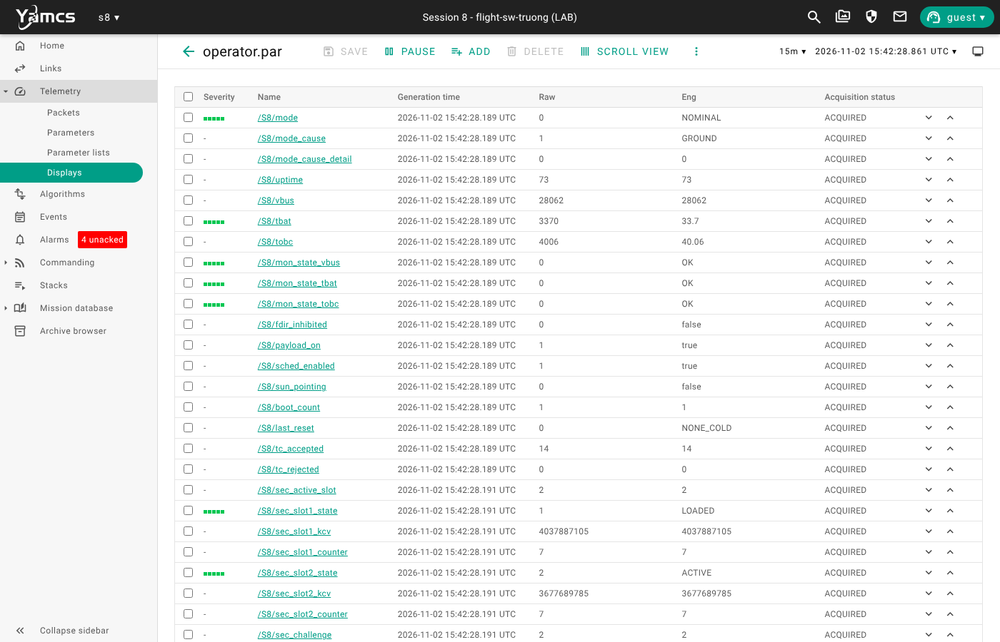
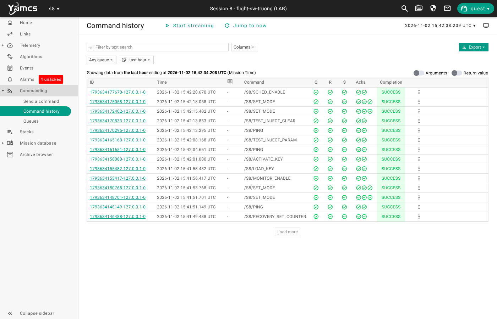
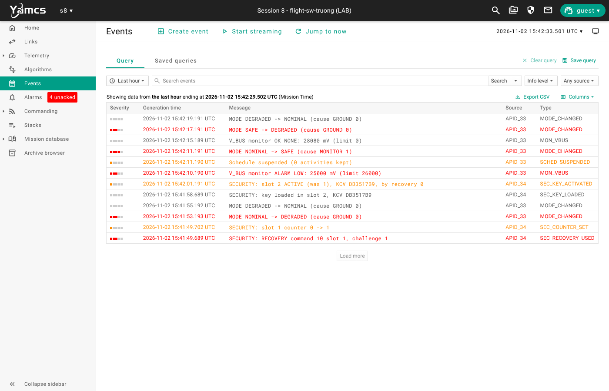
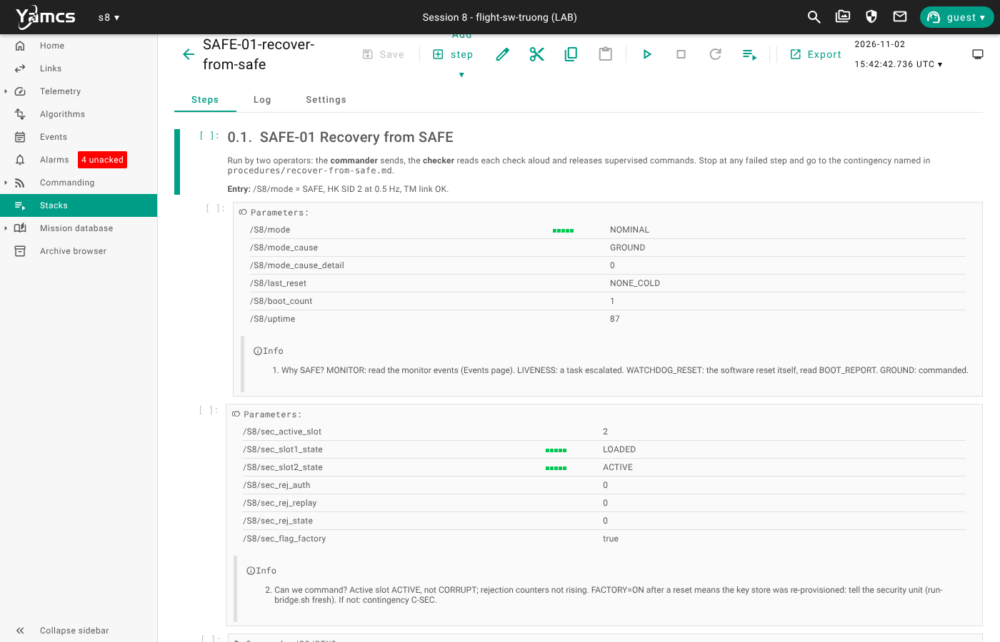

# Lab 8.3 - Ground segment: Yamcs, MDB, security unit, procedure

```
Yamcs 5.13.7  --TC  :10025-->  bridge/sc_bridge.py            --TC: lines-->  spacecraft
(instance s8) <--TM :10015---  ground security unit:            <--TM: lines--  lab8-test.host
 web :8090                      keys, counters, challenge,                      or SIS (lab8-test.exe)
                                key generation and wrapping
```

| Path | What |
|---|---|
| `tools/gen_mdb.py` | Generates the MDB from one table of what the flight software sends and accepts (each table names the C function) |
| `yamcs/mdb/s8.xml` | The XTCE MDB (generated, do not edit): HK SID 1/2/3, 26 event layouts, TM(1,x), TM(17,2), 18 commands, alarms |
| `yamcs/etc/` | `yamcs.yaml`, `yamcs.s8.yaml` (links, PUS event decoder, MDB), `events.json` (generated templates), `command-queue.yaml` (supervised queue), `processor.yaml` |
| `bridge/sc_bridge.py` | Spacecraft link and ground security unit |
| `displays/operator.par` | Operator display: mode, health, key slots, KCVs, counters, rejections |
| `procedures/` | SAFE-01 recovery from SAFE: `.ycs` stack for Yamcs and `.md` with contingency C-SEC |
| `tools/check_mdb.py` | MDB vs the ground decoders, field by field (5 460 comparisons) |
| `tools/yamcs_check.py` | End to end through Yamcs' REST API (`--rekey` adds a key change) |
| `tools/run_procedure.py` | Runs a `.ycs` stack from a script |
| `logs/` | `yamcs-check-host-sim.log` (19/19), `SAFE-01-run-host-sim.log` |
| `docs/` | `mdb.md` (the database as tables), screenshots |

## Running

Needs Java 17+ and Python 3 with `cryptography` (`sudo apt install openjdk-17-jre-headless python3-cryptography`).

```
cd labs/session-08/lab-8.3-ground-segment
./run-bridge.sh fresh          # terminal 1: spacecraft (host simulation) + security unit
./run-yamcs.sh                 # terminal 2: first run downloads Yamcs 5.13.7 into .run/
# browser: http://localhost:8090  -> instance s8
python3 tools/yamcs_check.py --rekey      # optional, terminal 3: automatic check
```

On SIS instead of the host simulation: `RTEMS_PREFIX=... ./run-bridge.sh fresh sis`.

**First contact.** A fresh spacecraft (`fresh`, or any SIS start) is in factory key state and refuses commands until its counter floor is set. The bridge prints `FIRST CONTACT NEEDED`. In Yamcs: Commanding > Send a command > `RECOVERY_SET_COUNTER`, slot `SLOT_1`, floor `0`; then Commanding > Queues > supervised > accept it (critical commands wait there for a second operator). From then on every command works directly. `yamcs_check.py` does this step by itself.

## Screen recording (under 2 minutes)

Before recording: start both terminals, open http://localhost:8090, do the first contact, and open three tabs:
Telemetry > Displays > `operator.par`, Commanding > Command history, Events.

| Time | Show | Do |
|---|---|---|
| 0:00-0:15 | `operator.par` | Values updating every second: mode NOMINAL, `uptime` counting, key slot 1 ACTIVE, KCV, counter |
| 0:15-0:45 | Commanding > Send a command | `SET_MODE`, mode `DEGRADED`, Send. (Significance "warning": confirm.) |
| 0:45-1:10 | Command history | The row: Q, R, S ticks, then Accepted, PUS_Completed (TM(1,7)), then Complete when HK shows DEGRADED. Open the row to show the stages and times |
| 1:10-1:25 | `operator.par` | `mode` = DEGRADED (yellow alarm), `sec_slot1_counter` +1 |
| 1:25-1:45 | Events | `MODE NOMINAL -> DEGRADED (cause GROUND 0)` decoded from the event template |
| 1:45-1:55 | Command history | Optional: `SET_MODE` NOMINAL to go back |

Alternative with more content (about 1:50): put the spacecraft in SAFE first (`TEST_INJECT_PARAM` V_BUS 25000, samples 0), then record Stacks > SAFE-01 > Run: checks, commands with their verification, SAFE -> DEGRADED -> NOMINAL.






## Design notes

- **Keys stay out of Yamcs.** The MDB's LOAD_KEY has one argument, the slot. The bridge generates the key, wraps it under the KEK (AES-128-CCM) and prints the key check value, which the operator compares with `sec_slotN_kcv` before ACTIVATE_KEY.
- **Recovery commands** (RECOVERY_SET_COUNTER, RECOVERY_ACTIVATE) are signed by the bridge with the recovery key and the challenge from the latest HK SID 3. A floor of 0 means "the security unit's safe floor" (above every counter value it has ever transmitted).
- **Verifiers.** Accepted and Complete match TM(1,1/2) and TM(1,7/8) by request ID (`org.yamcs.pus.Pus1Verifier`). SET_MODE has TM(1,7) as an execution stage and completes only when the HK mode equals the argument (NCR-01 from Session 7). A command rejected before authentication gets no TM(1,2): its Accepted stage ends in TIMEOUT, and the reason is in the security events.
- **Time.** Onboard time counts from boot, so Yamcs stamps packets with reception time (GenericPacketPreprocessor, `timestampOffset: -1`); `obt_coarse` / `obt_fine` are still decoded.
- **Lab only.** No Yamcs users, no TLS; the security unit's state (keys included) is a JSON file in `.run/`. See the ground segment note in `../lab-8.4-security-analysis/security-analysis.md`.
